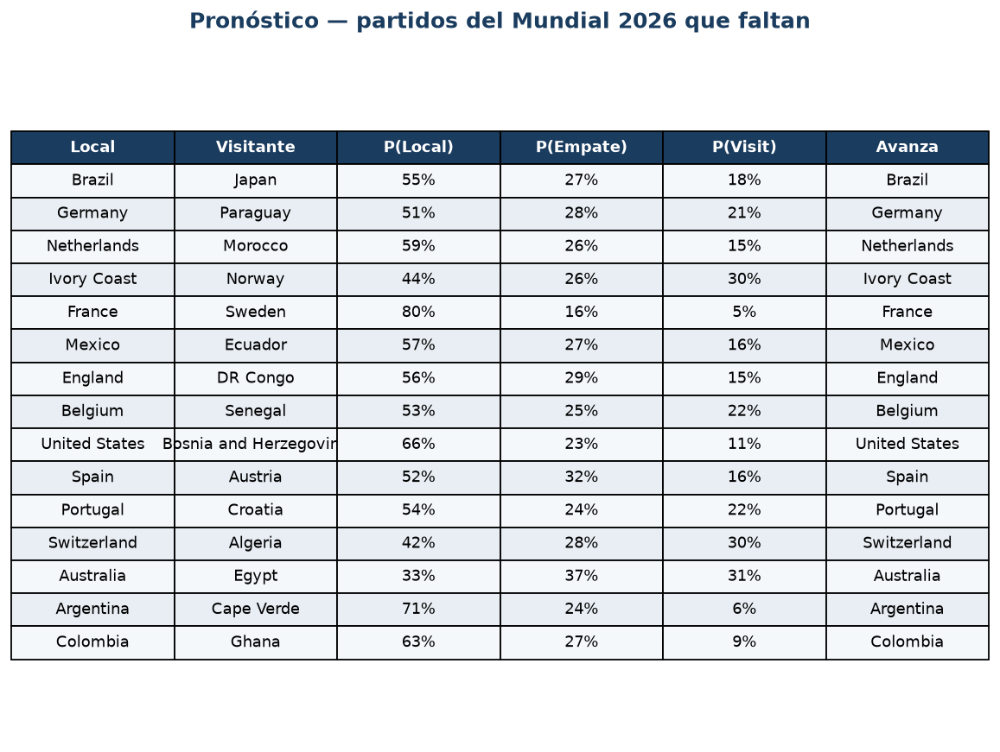
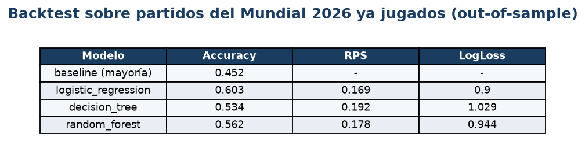
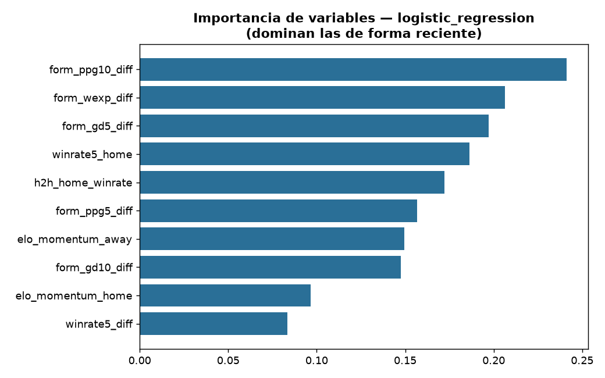
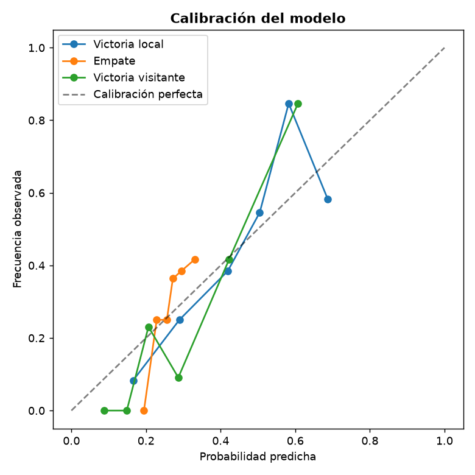

# Predicción del Mundial 2026 con Machine Learning

Proyecto de **clasificación supervisada 1X2** (Victoria local / Empate / Victoria visitante) que
**entrena con partidos internacionales reales** y **pronostica los partidos del Mundial 2026 que faltan
jugar**, priorizando el **rendimiento reciente** de equipos y jugadores.

> **Entregable principal:** el notebook de Google Colab [`notebooks/Mundial_ML_Colab.ipynb`](notebooks/Mundial_ML_Colab.ipynb).
> Al hacer **Runtime → Run all** descarga datos reales, entrena, mide su acierto sobre los partidos del
> Mundial ya jugados (backtest out-of-sample) y pronostica los que faltan.

---

## 📸 Cómo funciona

**1. Pronóstico de los partidos del Mundial 2026 que faltan** (probabilidades 1X2 + quién avanza):



**2. Backtest sobre los partidos del Mundial ya jugados** (out-of-sample: el modelo no los vio al entrenar):



**3. El modelo lo dominan las variables de FORMA RECIENTE** (no la historia antigua):



**4. Calibración** — un "X %" predicho ocurre ~X % de las veces:



---

## 1. Cómo correrlo (Google Colab)

1. Subí `notebooks/Mundial_ML_Colab.ipynb` a [colab.research.google.com](https://colab.research.google.com).
2. **Runtime → Run all** (~2-3 min). No necesita configuración: usa datos reales por defecto.
3. (Opcional) Para el desempeño individual de jugadores, pegá tu **API key de API-Football** cuando la pida (ver §4).

Para correr el motor localmente (sin Colab): `python run_all.py` tras instalar `requirements.txt`.

---

## 2. Stack de modelos

El proyecto combina modelos **deterministas** (reglas/estadística cerrada) y **probabilísticos / de
aprendizaje automático supervisado**, más líneas base y métricas probabilísticas.

### 2.1 Modelos deterministas / estadísticos
| Modelo | Qué hace | Rol |
| --- | --- | --- |
| **Elo** (rating incremental) | Actualiza la fuerza de cada selección tras cada partido (K=40, adaptación rápida). | Se usa su **momentum reciente** (cambio de Elo en los últimos partidos), no el valor histórico absoluto. |
| **Dixon-Coles (1997)** | Modelo de marcadores: dos Poisson (ataque/defensa) + corrección `τ` de marcadores bajos + **decaimiento temporal** `φ(t)=exp(−ξt)` (lo reciente pesa más). | Baseline probabilístico fuerte y opción de generador de features 1X2. |

### 2.2 Modelos probabilísticos / ML supervisado (clasificación 1X2)
| Modelo | Tipo |
| --- | --- |
| **Regresión Logística** | Lineal, probabilístico |
| **Árbol de Decisión** | No lineal, interpretable |
| **Random Forest** | Ensemble (bagging) |
| **XGBoost** *(opcional)* | Ensemble (boosting) |

### 2.3 Líneas base
- **Clase mayoritaria** (predecir siempre el resultado más frecuente).
- **Dixon-Coles puro** (probabilidades 1X2 derivadas del modelo de goles).

### 2.4 Métricas de evaluación
- **Accuracy** y **F1 macro** (acierto y balance entre clases).
- **Log-loss**, **RPS** (Ranked Probability Score, sensible al orden 1X2) y **Brier** — reglas de
  puntuación *propias*, lo correcto para un problema con empate.
- **Curva de calibración** (reliability diagram): valida que un "X %" predicho ocurra ~X % de las veces.

### 2.5 Enfoque de RECENCIA (núcleo del proyecto)
Para que manden los **últimos resultados** y no la historia profunda:
- Se **descarta el Elo histórico** absoluto; el modelo se entrena con **features de forma reciente**:
  forma en varias ventanas (últimos 3/5/10), forma **ponderada exponencialmente**, diferencia de gol
  reciente, racha (`streak`), win-rate y **momentum de Elo**.
- El clasificador se entrena **pesando más los partidos recientes** (decaimiento exponencial, half-life ~1 año).
- Dixon-Coles aplica el mismo principio vía su decaimiento temporal `ξ`.
- En eliminación se reporta además **"quién avanza"** = P(gana) + ½·P(empate) (los penales reparten el empate).

---

## 3. Datos

| Fuente | Uso | Acceso |
| --- | --- | --- |
| **martj42/international_results** | Partidos internacionales reales (~16.000 desde 2010, incluye los fixtures del Mundial 2026). Base de entrenamiento, etiquetas y forma de equipo. | CSV público (CC0), sin clave. |
| **API-Football** | **Rating reciente del plantel** por selección (desempeño individual). | Requiere API key gratuita (ver §4). |
| **Transfermarkt / FBref** | Valor de mercado, lesiones, forma de jugador. | *Stubs* incluidos para enriquecer (no activos por defecto). |

Si no hay internet, el notebook cae a un **generador sintético** para no romperse.

---

## 4. API key de API-Football (desempeño individual)

El rating de los jugadores se obtiene de [API-Football](https://www.api-football.com/).

1. Registrate gratis en **[dashboard.api-football.com/register](https://dashboard.api-football.com/register)** (sin tarjeta).
2. Copiá tu **API key** del dashboard (sección *Account*).
3. En el notebook (sección 8b), pegala cuando aparezca el prompt `getpass` (no se guarda en el archivo).

**Uso técnico:** peticiones HTTP con header `x-apisports-key: <KEY>` a `https://v3.football.api-sports.io`.
Se calcula el **rating de plantel** = promedio del rating de los jugadores ponderado por minutos jugados.

**Limitaciones honestas del free tier (100 req/día):**
- Los ratings de plantel están disponibles para **selecciones grandes**, pero **faltan para varias
  chicas** (p.ej. Cape Verde no tiene datos).
- Las **lesiones de selección no se cubren** en el free tier.
- Por la cuota, este dato **no entra al entrenamiento histórico**: se usa como **señal complementaria del
  pronóstico**, no como feature entrenada. El notebook cachea y respeta el límite (sleep entre llamadas).

---

## 5. Resultados (datos reales, validados)

- **Backtest out-of-sample** sobre los partidos del Mundial 2026 ya jugados: **~60 % de acierto 1X2**
  (vs ~45 % de la línea base), RPS ~0.17.
- Las features que más pesan son de **forma reciente** (forma últimos 10, forma ponderada, dif. de gol
  reciente, momentum), no de historia antigua.

---

## 6. Estructura del proyecto

```
machine learning/
├── notebooks/
│   ├── Mundial_ML_Colab.ipynb   # ENTREGABLE: notebook de Colab (datos reales + pronóstico WC2026)
│   ├── pipeline_core.py         # Código autocontenido y testeado (features, Elo, Dixon-Coles, métricas)
│   └── build_notebook.py        # Genera el .ipynb a partir de pipeline_core.py
├── src/                         # Motor modular equivalente (data, features, models, scraping, app)
├── docs/                        # Documentación del curso (épicas, casos de prueba, trazabilidad, defectos)
├── tests/                       # Pruebas automatizadas (pytest), incl. test de NO fuga de información
├── requirements.txt
└── run_all.py                   # Pipeline completo local
```

## 7. Instalación local (opcional)

```powershell
python -m venv .venv
.\.venv\Scripts\Activate.ps1
python -m pip install --trusted-host pypi.org --trusted-host files.pythonhosted.org -r requirements.txt
python run_all.py      # o: pytest -q
```

## 8. Limitaciones y trabajo futuro

- Desempeño individual: cobertura parcial en el free tier; se puede ampliar con un plan pago o con
  Transfermarkt/FBref (stubs incluidos).
- Lesiones: no disponibles para selecciones vía API-Football free; pendiente vía Transfermarkt.
- Knockouts: los penales se modelan como reparto del empate (½), no como un modelo de penales dedicado.
